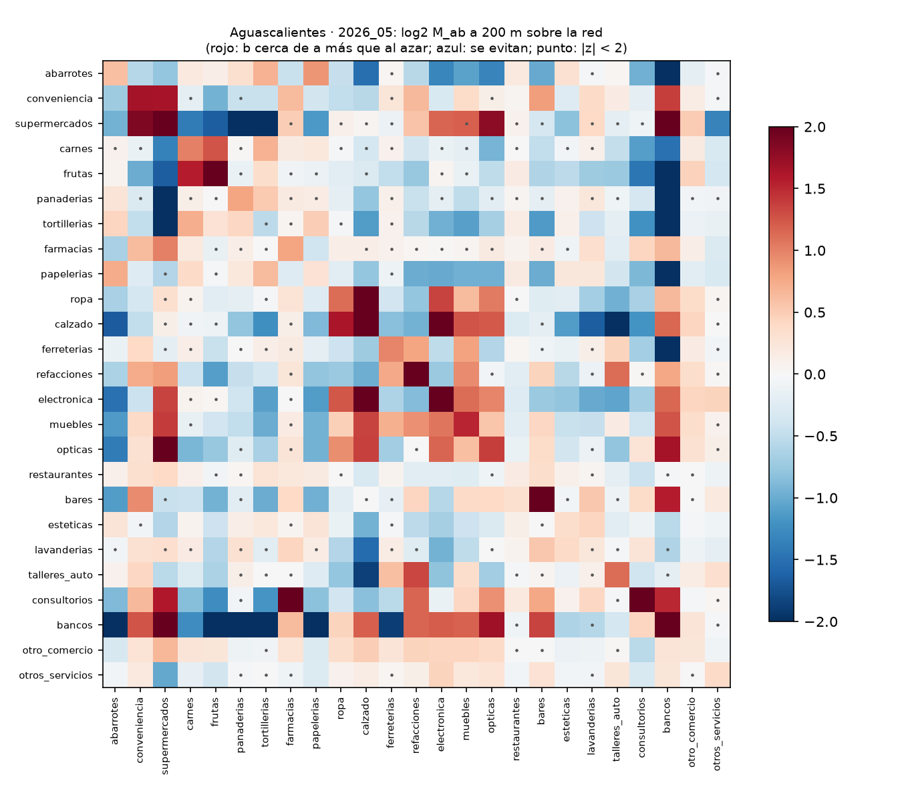
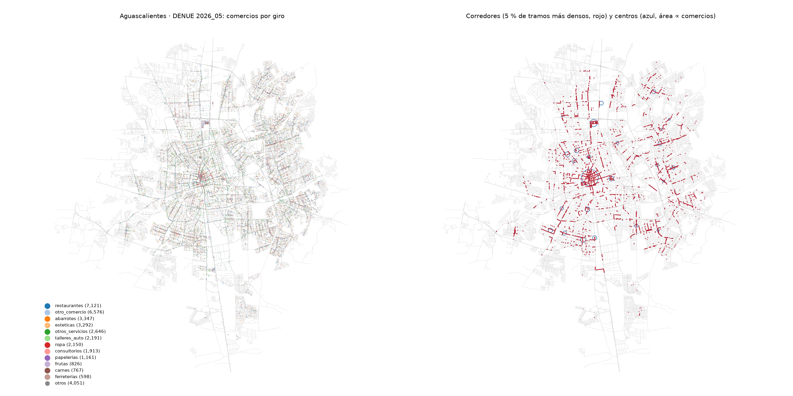
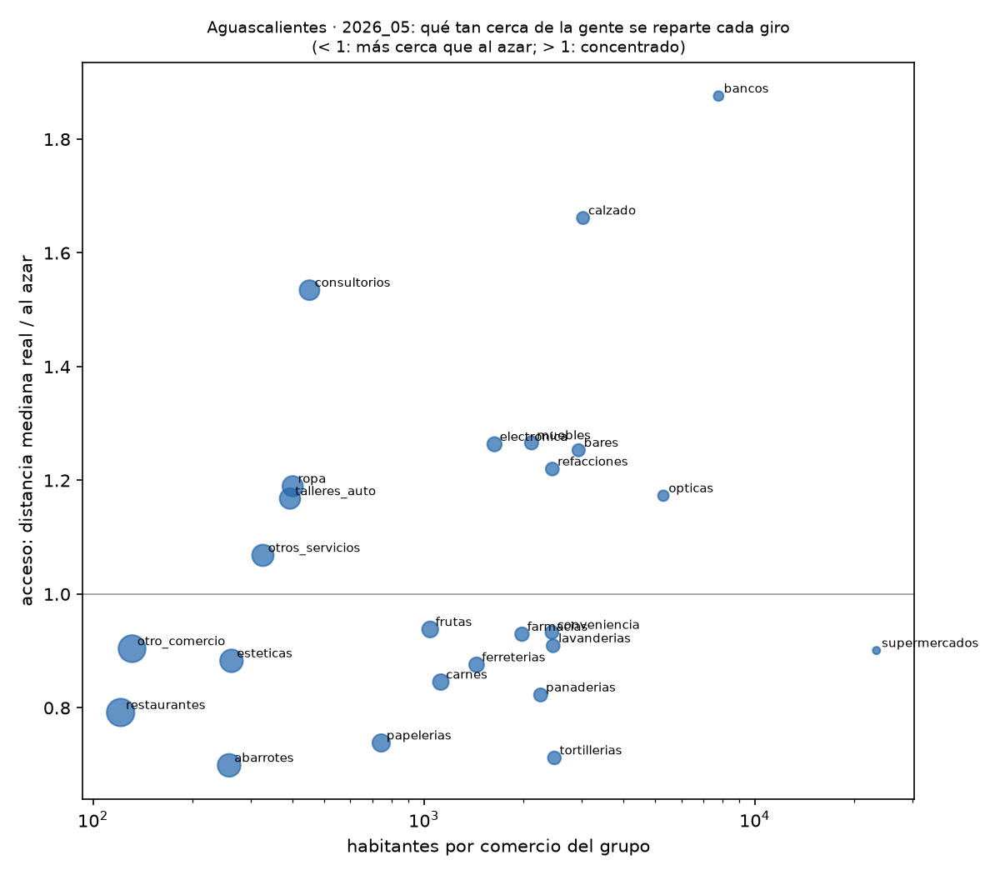

# Fase 0: patrones observados

Primer cálculo de los patrones P1–P5 (ver [README](../README.md#41-patrones-los-observables))
en tres ciudades medias, con el DENUE de 2015 y de mayo 2026. El objetivo de esta fase es
saber si los patrones son lo bastante claros y estables para servir de oráculo.

**Respuesta corta: sí.** Los patrones son fuertes, casi no cambian en 11 años y se
parecen mucho entre ciudades, aunque más de la mitad de los comercios se renovó.

## Datos

| Ciudad | Localidad urbana | Red de calles | Comercios 2015 | Comercios 2026 |
|---|---|---|---|---|
| Aguascalientes | 010010001 | 3,272 km | 29,685 | 36,639 |
| Mérida | 310500001 | 5,197 km | 34,082 | 39,226 |
| Hermosillo | 260300001 | 3,705 km | 21,036 | 23,351 |

- **Comercios:** unidades del DENUE dentro del polígono de la localidad urbana
  (Marco Geoestadístico 2025) en 25 grupos de giro ([config/giros.csv](../config/giros.csv)):
  comercio al por menor, comida, servicios personales, consultorios y bancos. Se excluyen
  manufactura, oficinas, gobierno y escuelas.
- **Red:** calles de OpenStreetMap (sin autopistas, veredas ni estacionamientos), partidas
  en intersecciones; componente conexa más grande dentro del polígono con 1 km de margen.
- Cada comercio se ubica en el tramo de calle más cercano (a menos de 150 m) y se
  inserta como nodo en la red. **Todas las distancias son sobre la red.**

Reproducir:

```bash
uv run python -m emergencia.ciudad --denue datos/denue --marco <00l.parquet> --osm <mexico.osm.pbf>
uv run python -m emergencia.patrones
uv run python -m emergencia.comparar
```

## P1. Atracción y repulsión entre giros

Coeficiente de Jensen *M<sub>ab</sub>* a 200 m sobre la red: cuántos comercios del giro *b*
rodean a los del giro *a*, comparado con repartir los giros al azar entre los mismos
locales. Se compara además con 30 permutaciones para marcar lo que no es significativo.



Se ven dos familias:

- **Bienes de comparación**, que se juntan entre sí: ropa, calzado, electrónica, muebles,
  ópticas, bancos y consultorios. Calzado consigo mismo: *M* ≈ 5–10; bancos: *M* ≈ 8–28
  (según ciudad, año y radio).
- **Bienes de cercanía**, que cubren el territorio y evitan los centros: abarrotes,
  tortillerías, panaderías, papelerías, carnes. Las tortillerías se repelen entre sí
  (*M* ≈ 0.2–0.7 en casi todos los casos; la excepción es Hermosillo 2026 a 200 m, con 1.4).
  Abarrotes y restaurantes quedan cerca del azar (*M* ≈ 1.1–2.0).

**Estabilidad** (correlación de log₂ *M<sub>ab</sub>* sobre los 625 pares; signo entre los
pares significativos en ambas):

| | r | mismo signo |
|---|---|---|
| Misma ciudad, 2015 vs 2026 | 0.88 · 0.88 · 0.89 | 97–98 % |
| Entre ciudades, misma versión | 0.72–0.86 | 91–94 % |

La estructura de atracción y repulsión es casi la misma en ciudades distintas. Es la
primera señal de que podría haber reglas comunes (la pregunta de universalidad).

## P2. Centros

Densidad de cada sitio = comercios a ≤ 300 m sobre la red. Un centro es un conjunto
conexo (enlaces ≤ 150 m) de sitios con densidad por encima de la media que ve un
comercio típico, con al menos 20 comercios.

| | Centros | Pendiente rango–tamaño | Comercios en centros |
|---|---|---|---|
| Aguascalientes 2015 / 2026 | 25 / 25 | −1.29 / −1.02 | 21 % / 19 % |
| Mérida 2015 / 2026 | 6 / 10 | −1.74 / −1.27 | 16 % / 15 % |
| Hermosillo 2015 / 2026 | 28 / 29 | −1.13 / −1.19 | 26 % / 24 % |

Hay jerarquía: un centro histórico grande y muchos centros menores, con una relación
rango–tamaño cercana a Zipf (pendiente ≈ −1). Este patrón es **sensible al umbral**
(con 1.5× o 2× la media quedan 2–7 centros; ver `sensibilidad` en cada `resumen.json`).
Para usarlo como oráculo conviene compararlo como curva en función del umbral, no con
un solo umbral.

## P3. Corredores

| | Gini (comercios vs. longitud de calle) | Comercios en el 5 % de la calle | Calle sin comercio |
|---|---|---|---|
| Aguascalientes 2015 / 2026 | 0.85 / 0.83 | 51 % / 48 % | 69 % / 64 % |
| Mérida 2015 / 2026 | 0.86 / 0.84 | 54 % / 50 % | 72 % / 68 % |
| Hermosillo 2015 / 2026 | 0.84 / 0.84 | 49 % / 49 % | 70 % / 68 % |

**La mitad de los comercios está en el 5 % de la longitud de calles**, en las tres
ciudades y en los dos años. Las avenidas (primarias, secundarias y terciarias en OSM)
tienen 10–23 comercios por km y las calles residenciales 5–8. Cuál de las tres jerarquías
de avenida domina cambia según la ciudad. Las calles peatonales del centro de Mérida
llegan a 74–94 por km.



Mérida y Hermosillo: [mapa](img/fase0_mapa_merida.png) · [Jensen](img/fase0_jensen_merida.png) ·
[mapa](img/fase0_mapa_hermosillo.png) · [Jensen](img/fase0_jensen_hermosillo.png).
Cifras completas: [fase0_comparacion.json](fase0_comparacion.json).

## P4. Relación con la demanda

Población del Censo 2020 por manzana (Aguascalientes 864 mil, Mérida 917 mil, Hermosillo
851 mil habitantes en la localidad), ubicada sobre la red. Para cada giro se mide la
distancia mediana sobre la red, ponderada por población, de una manzana al comercio más
cercano de ese giro, y se divide entre la misma medida con el mismo número de comercios
puestos al azar sobre las calles. Menos de 1: el giro se reparte para quedar cerca de la
gente. Más de 1: se concentra aunque quede más lejos.



| Giro | Aguascalientes 2015 / 2026 | Mérida 2015 / 2026 | Hermosillo 2015 / 2026 |
|---|---|---|---|
| Abarrotes | 0.73 / 0.70 | 0.80 / 0.78 | 0.78 / 0.75 |
| Tortillerías | 0.72 / 0.71 | 0.76 / 0.76 | 0.76 / 0.78 |
| Papelerías | 0.74 / 0.74 | 0.79 / 0.80 | 0.80 / 0.75 |
| Ropa | 1.23 / 1.19 | 2.00 / 1.33 | 2.16 / 1.41 |
| Calzado | 1.58 / 1.66 | 1.98 / 1.61 | 1.94 / 1.61 |
| Consultorios | 1.70 / 1.53 | 1.65 / 1.54 | 2.09 / 2.12 |
| Bancos | 1.86 / 1.88 | 1.63 / 1.82 | 1.88 / 2.18 |

Es la misma separación de P1 vista desde la población: los bienes de cercanía están más
cerca de la gente que el azar (0.70–0.80) y los de comparación más lejos (1.2–2.2), con los
mismos valores en las tres ciudades. Además hay una **tendencia**: entre 2015 y 2026 los
bienes de comparación se dispersan (la ropa en Mérida pasa de 2.0 a 1.33; en Hermosillo, de
2.16 a 1.41).

Mérida: [demanda](img/fase0_demanda_merida.png) · Hermosillo: [demanda](img/fase0_demanda_hermosillo.png).

## P5. Dinámica (2015 → 2026)

Cada unidad se sigue por su `id` del DENUE.

| | Comercios 2015 | Siguen en 2026 | Altas | Bajas | Cambian de giro | Se mueven > 50 m |
|---|---|---|---|---|---|---|
| Aguascalientes | 29,685 | 44 % | 23,480 | 16,526 | 733 | 1,284 |
| Mérida | 34,082 | 40 % | 25,517 | 20,373 | 953 | 1,628 |
| Hermosillo | 21,036 | 41 % | 14,640 | 12,325 | 612 | 970 |

En 11 años se renueva más de la mitad del comercio, pero los patrones P1–P4 casi no
cambian. **El patrón se mantiene mientras sus ocupantes se reemplazan.** Es la situación
del flock: la forma persiste aunque los pájaros cambien de lugar.

Dos resultados que orientan las reglas del simulador:

1. **Las altas se ubican cerca de su propio giro, pero menos que los que ya estaban.**
   Comercios del mismo giro a ≤ 200 m alrededor de las altas, entre lo mismo alrededor de
   puntos al azar de la calle, comparado con lo mismo alrededor de los comercios que ya
   existían:

   | Giro | Aguascalientes: altas / existentes | Mérida | Hermosillo |
   |---|---|---|---|
   | Ropa | 26 / 43 | 72 / 128 | 56 / 106 |
   | Calzado | 200 / 229 | 155 / 317 | 101 / 140 |
   | Consultorios | 22 / 35 | 85 / 118 | 92 / 105 |
   | Abarrotes | 2.0 / 2.4 | 2.3 / 2.4 | 1.8 / 2.0 |

   Es coherente con la dispersión de P4.

2. **La tasa de baja casi no depende de la competencia cercana.** Por ejemplo, la
   fracción de abarrotes que desaparece es la misma (≈ 0.46 en Aguascalientes, ≈ 0.55 en
   Mérida y Hermosillo) con 0, 1–2 o 3+ abarrotes a ≤ 200 m. En ropa y calzado es incluso
   algo menor con más vecinos del mismo giro. Con estos datos, **el patrón se sostiene por
   dónde se instalan los comercios, no por cuáles mueren**: una regla de localización con
   una tasa de baja casi constante podría bastar.

Cuidado: entre 2015 y 2026 hay dos Censos Económicos, así que parte de las altas y bajas
es actualización del directorio y no apertura o cierre real. Con la serie completa se
podrá separar por periodos censales.

## Qué sigue

1. Repetir con toda la serie del DENUE (2015–2026), separando la dinámica por periodos
   censales.
2. Fase 1: simulador sobre la red y prueba de recuperación con lugares centrales.

Para el simulador, esta fase deja cuatro objetivos claros:

- **(a) Atracción y repulsión:** la matriz de Jensen tiene una estructura en dos bloques
  que una regla mínima debería reproducir.
- **(b) Corredores:** la concentración es extrema y casi idéntica entre ciudades, así que
  la regla tendrá que explicarla, probablemente a través de la red de calles.
- **(c) Acceso a la población:** los giros de cercanía y los de comparación se separan
  igual en las tres ciudades.
- **(d) Dinámica:** la evidencia apunta a una regla de localización con atracción por el
  propio giro y una tasa de baja casi constante.
